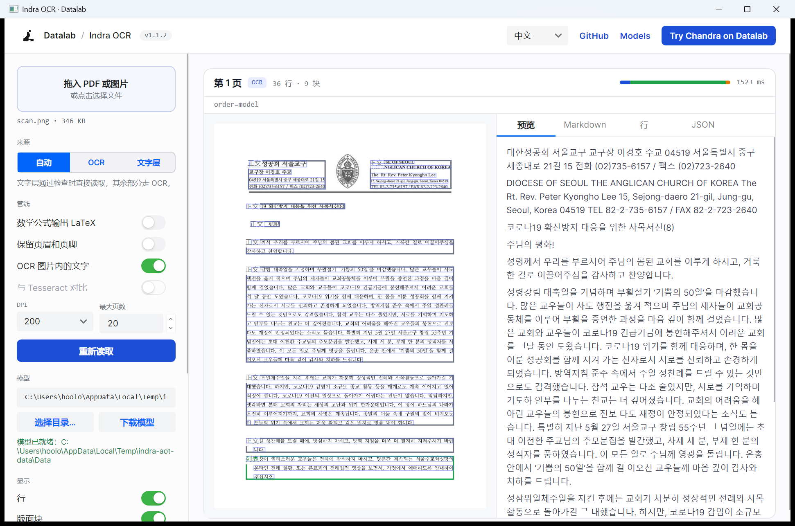
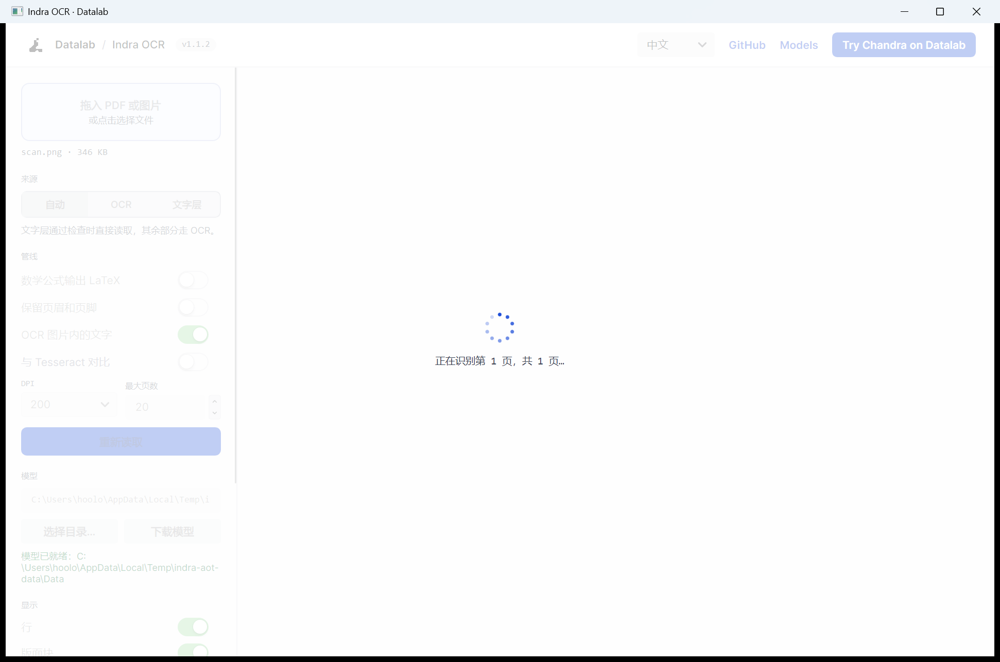

# Indra OCR（.NET / C# 版）使用说明

本文面向使用者，说明如何构建、运行 `.NET` 版 Indra OCR 的命令行工具（CLI）、本地 Web 查看器（Viewer）和桌面 GUI。

- 源码位置：本仓库 `dotnet/`
- 参考实现：同仓库的 Python 包 `indra_ocr/`（两者输出已做逐页对齐）
- 当前状态：S0–S7 与桌面 GUI 已完成；Windows x64 已验证（桌面版仅提供 NativeAOT 发布），Linux/macOS 原生库属于 S8 收尾项

---

## 目录

1. [前置条件](#1-前置条件)
2. [构建](#2-构建)
3. [模型准备](#3-模型准备)
4. [命令行工具（CLI）](#4-命令行工具cli)
5. [本地 Web 查看器（Viewer）](#5-本地-web-查看器viewer)
6. [桌面 GUI（Avalonia）](#6-桌面-guiavalonia)
7. [在 C# 代码中调用](#7-在-c-代码中调用)
8. [与 Python 版的差异与限制](#8-与-python-版的差异与限制)
9. [常见问题](#9-常见问题)
10. [测试与一致性验证](#10-测试与一致性验证)

---

## 1. 前置条件

| 项 | 要求 |
|---|---|
| 操作系统 | Windows x64（已实测）；Linux/macOS 需等 S8 的跨平台原生包 |
| .NET SDK | **.NET 10 SDK**（.NET 11 SDK 也能编译 `net10.0`） |
| 内存 | 建议 ≥ 2 GB 可用；大页扫描单页可能到 GB 级 |
| 网络 | 首次运行需从 Hugging Face 下载模型（约 76 MB；`--math` 另约 20 MB） |
| 运行库 | 若提示找不到 `pdfium.dll` / OpenCV 原生库，安装 **Microsoft Visual C++ 2015–2022 x64 运行库** |

检查 SDK：

```powershell
dotnet --version
```

---

## 2. 构建

在仓库根目录执行：

```powershell
cd dotnet
dotnet build -c Release
```

只发布 CLI（生成可直接分发的目录）：

```powershell
dotnet publish src/IndraOcr.Cli -c Release -r win-x64 --self-contained false -o ..\publish\cli
```

发布 Viewer：

```powershell
dotnet publish src/IndraOcr.Viewer -c Release -r win-x64 --self-contained false -o ..\publish\viewer
```

> `--self-contained false` 需要目标机器安装 .NET 10 运行时；要单文件/自带运行时，把参数改为 `--self-contained true`（体积会明显变大）。

构建后也可以直接用 `dotnet run --project ...` 运行，无需先发布。

---

## 3. 模型准备

### 3.1 自动下载（默认）

CLI 与 Viewer 首次启动时会自动下载模型：

- 仓库：`datalab-to/indra-ocr`
- 版本：`v1.1.0`
- 缓存目录（Windows）：`%LOCALAPPDATA%\indra-ocr\models\datalab-to--indra-ocr\v1.1.0`
- 默认文件：`det.onnx`、`rec.onnx`、`order.onnx`、`orient.onnx`、`script.onnx`、`rec_cjk/rtl/world.onnx`、`lm*.npz`、`meta.json`
- 使用 `--math` 时另外下载：`mathcls.onnx`、`math_enc.onnx`、`math_dec_init.onnx`、`math_dec_step.onnx`、`math_meta.json`

下载走 Hugging Face 的普通 `resolve` 直链（不使用 Xet），因此镜像可用：

```powershell
# 国内网络建议
$env:HF_ENDPOINT = "https://hf-mirror.com"
# 私有仓库或限流时可设置
$env:HF_TOKEN = "hf_xxx"
```

> 下载地址由 `HF_ENDPOINT` 决定，默认 `https://huggingface.co`。C# 下载器不需要 `HF_HUB_DISABLE_XET`。

### 3.2 使用本地模型目录

已有模型文件时，用 `--model-dir` 指向目录，或设置环境变量：

```powershell
$env:INDRA_OCR_MODEL_DIR = "D:\models\indra-ocr"
```

目录至少需要 `det.onnx`、`rec.onnx`（或 `rec.int8.onnx`）、`meta.json`；`order.onnx` 可选（没有时阅读序回退到 XY-cut）。`--math` 需要数学模型齐全。

### 3.3 模型许可

代码为 Apache-2.0；模型权重为修改版 OpenRAIL-M，**不随程序打包**，由运行时下载或用户自备目录。商业使用限制见原仓库 README。

---

## 4. 命令行工具（CLI）

### 4.1 快速开始

```powershell
cd dotnet

# PDF → Markdown 到标准输出
dotnet run --project src/IndraOcr.Cli -- paper.pdf

# 多份 PDF，每份写一个 .md
dotnet run --project src/IndraOcr.Cli -- *.pdf --out results\

# 图片 → JSON（每页一个对象，含行、框、版面块、耗时）
dotnet run --project src/IndraOcr.Cli -- scan.png --format json

# 数学公式写成 LaTeX（$...$）
dotnet run --project src/IndraOcr.Cli -- paper.pdf --math

# 限制为 4 个核、只看前 10 页、并打印每页耗时
dotnet run --project src/IndraOcr.Cli -- book.pdf --cores 4 --max-pages 10 --timings
```

发布后的程序用法相同：

```powershell
..\publish\cli\IndraOcr.Cli.exe paper.pdf --format json
```

### 4.2 选项

| 选项 | 默认 | 说明 |
|---|---|---|
| `inputs...` | 必填 | PDF 或图片文件，可多个（空格分隔） |
| `--out DIR` | 无 | 每个输入写一个文件到该目录；目录不存在会自动创建 |
| `--format md\|text\|json` | `md` | 输出格式；`--out` 时扩展名分别为 `.md` / `.txt` / `.jsonl` |
| `--mode auto\|ocr\|text` | `auto` | `auto`：文字层通过检查就用文字层，否则 OCR；`ocr`：完全 OCR；`text`：即使检查不通过也用文字层 |
| `--no-image-ocr` | 关 | 文字层页面中，不对图片内的文字做 OCR |
| `--model-dir DIR` | 自动下载 | 模型目录 |
| `--cores N` / `--threads N` | 0（全部） | 使用的核数 |
| `--dpi N` | 200 | PDF 渲染分辨率 |
| `--max-pages N` | 0（全部） | 每个文件最多读多少页 |
| `--password PWD` | 无 | 加密 PDF 的密码 |
| `--math` | 关 | 数学行输出 LaTeX（首次会下载数学模型，速度更慢） |
| `--keep-furniture` | 关 | 在 Markdown 中保留页眉、页脚（默认丢弃） |
| `--timings` | 关 | 每页的 source、总耗时、note 打到 **stderr** |
| `--version` | — | 打印 `indra-ocr 1.1.2` |
| `-h`, `--help` | — | 帮助 |

### 4.3 输出格式

**Markdown（默认）**：标题、段落、列表、表格（HTML）、LaTeX（`--math`）。页眉页脚默认丢弃。

**text**：每行一条识别文本，按阅读序，用换行连接。

**json**：每页一个 JSON 对象，一行一条（JSON Lines）。字段：

```json
{
  "file": "paper.pdf",
  "page": 0,
  "source": "text",
  "rotation": 0,
  "skew": 0.0,
  "vertical": false,
  "note": "order=model",
  "lines": [
    { "box": [72.0, 60.5, 410.2, 84.1], "text": "Quarterly report", "conf": 1.0 }
  ],
  "markdown": "## Quarterly report\n\n...",
  "blocks": [
    { "label": "Text", "bbox": [72.0, 60.5, 410.2, 84.1], "text": "Quarterly report" }
  ],
  "timings": { "text_ms": 12.3, "det_ms": 41.0, "rec_ms": 60.2, "total_ms": 113.5 }
}
```

- `source`：`text`（PDF 文字层）、`ocr`、`hybrid`（文字层 + 图片内 OCR）、`error`
- `rotation`：页面被转正的角度（0/90/180/270）
- `skew`：被矫正的倾斜角
- `vertical`：竖排页
- `blocks[].label`：`Text`、`Section-Header`、`Page-Header`、`Page-Footer`、`List-Group`、`Table`、`Caption`、`Footnote`、`Table-Of-Contents`、`Form`
- `timings` 每次运行都会不同，不要用于比较

`--out` 写入文件时，内容末尾带一个换行；同名输入会依次生成 `name.md`、`name_2.md`、`name_3.md`。

### 4.4 退出码与错误输出

| 退出码 | 含义 |
|---|---|
| `0` | 全部成功 |
| `1` | 有输入失败，或模型不可用 |
| `2` | 参数错误（未知选项、非法取值、缺少参数值） |

- 单个输入失败不会中断其它文件；最后在 stderr 输出 `indra-ocr: N of M inputs failed`
- 单页失败会在 stderr 输出 `indra-ocr: <file> page <n>: <reason>`，该页仍输出空内容
- 参数错误示例：

```text
indra-ocr: error: argument --format: invalid choice: 'docx' (choose from md, text, json)
```

### 4.5 并行说明

- 一个文件内的页会并行处理：`--cores` 控制并发页数。
- 文件之间按输入顺序逐个处理（Python 版把所有文件的页放进一个全局进程池；这里做了简化）。
- 一个长 PDF 可以用满所有核；多个小文件目前不会彼此并行。
- ONNX Runtime 会话在工作线程间共享；PDFium 不是线程安全的，PDF 的渲染/文字层调用内部串行化，OCR 与版面计算仍可重叠。
- `--cores 1` 时按单页多线程（ONNX intra-op 线程数为核数）执行，结果与多核一致。

---

## 5. 本地 Web 查看器（Viewer）

### 5.1 启动

```powershell
cd dotnet
dotnet run --project src/IndraOcr.Viewer -- --port 8765 --threads 4
```

看到：

```text
Indra OCR viewer on http://localhost:8765  (4 threads)
```

浏览器打开 <http://localhost:8765>。文件只在本机处理，不会上传到外部服务。

发布后的启动方式：

```powershell
..\publish\viewer\IndraOcr.Viewer.exe --port 8765
```

> 通过 SSH 使用时做端口转发：`ssh -N -L 8765:localhost:8765 user@host`。

### 5.2 选项

| 选项 | 默认 | 说明 |
|---|---|---|
| `--port N` | 8765 | 监听端口（仅绑定 `127.0.0.1`） |
| `--threads N` | 4 | ONNX Runtime 线程数 |
| `--dpi N` | 200 | PDF 初始渲染分辨率 |
| `--max-pages N` | 20 | 每个文档初始读取页数上限 |
| `--mode auto\|ocr\|text` | auto | 页面初始来源模式 |
| `--no-image-ocr` | 关 | 初始不 OCR 图片内文字 |
| `--keep-furniture` | 关 | 初始保留页眉页脚 |
| `--math` | 关 | 初始把数学写成 LaTeX（首用会下载数学模型） |
| `--model-dir DIR` | 自动下载 | 模型目录 |
| `--tesseract` | 关 | 已接受但不可用（见下） |
| `--tesseract-lang LANG` | eng | 同上 |
| `--version` / `-h` | — | 版本 / 帮助 |

### 5.3 界面说明

- 左侧拖入或点击选择 PDF/图片；页会边识别边出现
- **Source**：Auto / OCR / Text layer，改变后点 “Read again with these options”
- **Pipeline**：数学 LaTeX、保留页眉页脚、OCR 图片内文字、DPI、最大页数
- **Show**：行框、版面块、块标签、阅读序（可随时开关）
- 每页右侧标签：
  - **Preview**：渲染后的 Markdown
  - **Markdown**：Markdown 源文本
  - **Lines**：逐行文本与置信度（悬停会高亮页面上的行）
  - **JSON**：与 CLI `--format json` 相同结构的对象
- 页面顶部显示来源（Text layer / OCR / hybrid）、行数、块数、旋转/倾斜信息，以及各阶段耗时条
- 运行统计显示每页平均耗时、pages/s、各阶段耗时

### 5.4 HTTP 接口（高级）

查看器提供与 Python 版相同的接口，便于脚本调用：

| 方法 | 路径 | 说明 |
|---|---|---|
| GET | `/`、`/index.html` | 查看器页面 |
| GET | `/info` | `{ "tesseract": false, "version": "...", "defaults": {...} }` |
| GET | `/logo.png` | 页面 logo |
| POST | `/upload` | 请求体为文件原始字节；返回 `{ "id": "...", "pages": N }` |
| POST | `/page` | JSON `{ "id": "...", "n": 0, "opts": { "mode": "auto", "math": false, "furniture": false, "image_ocr": true, "dpi": 200 } }` |

`/page` 返回该页的图片（JPEG data URI）、行/块、Markdown、来源、旋转/倾斜、JSON 与耗时；出错返回 HTTP 400 与 `{ "error": "..." }`。

示例：

```powershell
$bytes = [IO.File]::ReadAllBytes("scan.png")
$up = Invoke-RestMethod -Uri http://127.0.0.1:8765/upload -Method Post -Body $bytes
$body = "{`"id`":`"$($up.id)`",`"n`":0,`"opts`":{`"mode`":`"auto`"}}"
$page = Invoke-RestMethod -Uri http://127.0.0.1:8765/page -Method Post -ContentType "application/json" -Body $body
$page.source; $page.lines.Count
```

服务端只保留最近 5 个上传文档（临时 PDF 文件会随旧文档删除）。

---

## 6. 桌面 GUI（Avalonia）



界面按 Web 查看器布局实现：左侧选项，右侧逐页显示识别结果；页面图上叠加行框、版面块、块标签和阅读序。

### 6.1 启动与发布

开发运行：

```powershell
cd dotnet
dotnet run --project src/IndraOcr.Desktop
```

发布桌面版（**NativeAOT**，唯一支持的发布方式）：

```powershell
cd dotnet
pwsh ./publish-desktop.ps1
# 输出：dist\desktop\IndraOcr.Desktop.exe
```

脚本会先 `Rebuild` 再 `publish --no-build`，因为 Avalonia 的 XAML 编译挂在 `CoreCompile` 上，增量 `dotnet publish` 可能跳过它，导致 NativeAOT 程序缺少编译后的 XAML。直接运行 `dotnet publish` 不会启用 AOT。

NativeAOT 需要：

- .NET 10 SDK
- Visual Studio Build Tools 的 MSVC C++ 工具链（`link.exe`）
- Windows x64；输出约 256 MB（exe + 原生库 + 约 92 MB 的 `Data` 模型目录）
- 模型（v1.1.0，含数学）随 `Data` 目录发布，首次运行无需联网下载

发布后也可以把一个文件作为参数直接打开：

```powershell
dist\desktop\IndraOcr.Desktop.exe paper.pdf
dist\desktop\IndraOcr.Desktop.exe scan.png
```

文件也可以拖到左上角的虚线区域，或点击选择。识别在后台执行，页会逐页出现。

### 6.2 界面



- **语言**：右上角 `中文 / English` 切换，默认跟随系统语言；选择会记住（`%LOCALAPPDATA%\indra-ocr\desktop-language.txt`）。切换后静态文案、页卡、覆盖层标签、统计和提示立即更新
- **识别中**：整个窗口显示半透明遮罩 + 旋转点 Loading 动画，并禁止点击（侧栏同时禁用），完成或出错后恢复
- **Source**：Auto / OCR / Text layer，切换后点 “重新读取”
- **Pipeline**：Math as LaTeX、保留页眉页脚、OCR 图片内文字；DPI（150/200/300）；最大页数
- **Show**：Lines、Layout blocks、Block labels、Reading order，可随时开关（立即作用于所有已显示页）
- **Model**：模型路径默认是应用程序目录下的 `Data`；发布包已自带 v1.1.0 核心模型和数学模型的离线副本
  - 默认路径：`<IndraOcr.Desktop.exe 所在目录>\Data`；设置 `INDRA_OCR_MODEL_DIR` 可覆盖
  - `选择目录…`：改用其他模型目录
  - `下载模型`：下载/校验缺失文件到当前路径；勾选 Math 时连数学模型一起下载
  - 首次读取时如果当前路径缺模型，也会自动下载（状态栏显示进度）；把应用放在只读目录时请改用可写目录
- **RUN**：状态、每页耗时、pages/s、各阶段耗时
- 每页卡片：
  - 页图 + 覆盖层（行框 / 版面块 / 标签 / 阅读序）
  - 右上角 **预览 / Markdown / 行 / JSON**
  - `行` 中悬停某一行会高亮页面上的对应框；鼠标划过页面上的文本框，也会高亮该框并在右侧选中对应行（双向同步）
  - 顶部显示来源（文字层 / OCR / 混合）、行数、块数、旋转/倾斜、阶段耗时条


### 6.3 与 Web 查看器的区别

- 不启动 HTTP 服务，文件只在本地进程内处理
- 一次只打开一个文档；关闭窗口会取消正在读取的页
- 不支持 Tesseract 对照（界面中该项置灰）
- 高 DPI 屏幕自动按系统缩放显示；窗口尺寸会按屏幕可用区域收敛

---

## 7. 在 C# 代码中调用

引用 `IndraOcr` 项目后：

```csharp
using IndraOcr.Document;
using IndraOcr.Imaging;
using IndraOcr.Models;
using IndraOcr.Pipeline;

string models = ModelFiles.Resolve(path: null, math: false); // 或 "D:\\models"
using var ocr = new OrtOcr(models, threads: 4);
var conv = new Converter(ocr, dpi: 200, mode: "auto", imageOcr: true);

foreach (var (i, page) in conv.Convert("paper.pdf"))
{
    Console.WriteLine($"page {i + 1}: {page.Source}, {page.Lines.Count} lines");
    Console.WriteLine(page.Markdown ?? page.Text);
    // page.Lines  -> Box (x0,y0,x1,y1), Text, Conf
    // page.Blocks -> Label, Bbox, Text
    // page.Timings, page.Rotation, page.Skew, page.Vertical
}
```

内存中的图片：

```csharp
using var gray = ImageOps.LoadGray("scan.png"); // OpenCvSharp.Mat, CV_8UC1
var page = ocr.Read(gray);                      // 自动转向、倾斜矫正、版面与 Markdown
```

多文件/多核：

```csharp
using IndraOcr.Parallel;

foreach (var file in PageRunner.ConvertMany(paths, cores: 8, modelDir: models))
{
    if (file.Error is not null)
    {
        Console.Error.WriteLine(file.Error.Message);
        continue;
    }
    foreach (var (i, page) in file.Pages)
    {
        // ...
    }
}
```

> 注意：`Converter` 与 `System.Converter<TIn,TOut>` 同名。文件里同时 `using System;` 时请写全名
> `IndraOcr.Document.Converter`，或给类型起别名。

---

## 8. 与 Python 版的差异与限制

**已对齐**

- 整页输出：文本、阅读序、版面块、Markdown、`source/note/rotation/skew/vertical`
- `--format md` 与 Python CLI 在 Windows 上**逐字节相同**（UTF-8、CRLF、末尾换行）
- `--format json` 除 `timings` 外字段一致
- 检测框 ≤0.5 px；置信度 ≤1e-4（页面行置信度四舍五入到 4 位，允许一个显示步长）
- PDF 渲染与 pypdfium2 逐像素一致（SHA-256）

**差异**

| 项 | 说明 |
|---|---|
| 并行粒度 | C# 版逐文件处理、文件内分页并行；Python 用全局进程池 |
| Tesseract 对照 | Viewer 未实现；`--tesseract` 只提示不可用，`/info.tesseract=false` |
| 平台 | 目前 Windows x64；Linux/macOS 原生包在 S8 补齐 |
| 换行 | Windows 上按平台输出 CRLF，与 Python 文本模式一致 |

**已知限制（与 Python 版相同）**

- 复杂表格、手写体、退化扫描、竖排扫描识别效果有限
- `mask.onnx`（CenterMask）在默认模型集中不存在，因此未参与验证
- 图片区（`Picture` block）、真实竖排页、`table_heads=True` 缺少可触发样本
- 文字层数学行重读逻辑已实现，但合成 PDF 未被数学分类器命中

---

## 9. 常见问题

**Q：第一次运行很慢 / 卡在下载？**
A：首次需下载约 76 MB 模型。国内网络设置 `HF_ENDPOINT` 镜像（见 §3.1）。下载失败 CLI 会输出 `indra-ocr: could not download the models ...` 并退出 1。

**Q：提示 `DllNotFoundException: pdfium` 或 OpenCV 原生库加载失败？**
A：安装 VC++ 2015–2022 x64 运行库；确认发布时带了 `runtimes/win-x64/native`（使用 `-r win-x64` 发布）。不要只复制 `dll` 而漏掉 `runtimes` 目录。

**Q：PDF 里明明是文字，为什么没走文字层？**
A：文字层要通过可信度检查（不可见文字、坏字体映射、文字与页面不符等会回退 OCR）。用 `--mode text` 可以强制使用文字层；`--format json` 的 `note` 会说明原因。

**Q：`--math` 没生效？**
A：先确认数学模型已下载（`--math` 首次自动下载）；只有分类器判定为数学、且结果含 `$...$`、置信度 ≥0.9 的行才会替换。纯文本页面不会变化。

**Q：页眉页脚去哪了？**
A：默认从 Markdown 中丢弃；用 `--keep-furniture` 保留。

**Q：多核没有加速多少？**
A：PDF 的渲染与文字层调用受 PDFium 串行化限制；加速主要来自 OCR/版面。大 PDF 更明显；多个小文件当前是逐个处理的。

**Q：怎么确认我的构建没有偏离参考实现？**
A：在仓库根目录跑 `python tools/...` 生成黄金数据，再 `dotnet test`（见 §10）。

---

## 10. 测试与一致性验证

```powershell
cd dotnet
dotnet test
```

当前测试数量：**67**。没有模型目录时会自动跳过需要模型的用例；模型查找顺序：

1. 环境变量 `INDRA_OCR_MODEL_DIR`
2. Python 包的 Hugging Face 缓存（`~/.cache/huggingface/hub/models--datalab-to--indra-ocr/snapshots/*`）
3. 都没有则跳过

测试覆盖：

- 检测输入/输出张量、检测框、自适应二次检测
- 行裁剪（32px / 96px 窗口）、CTC 识别、script 分流、置信度竞争
- 语言模型 logp 与 beam search
- 转向、倾斜矫正、阅读序、版面块、Markdown
- PDF 渲染、文字层、auto/text/ocr 三种模式、混合页、密码、TIFF
- 数学分类与解码
- CLI 参数/格式/退出码/输出命名、并行分页
- Viewer 引擎与真实 HTTP 路由

更完整的迁移与验证说明见 [`../docs/PORT_TO_CSHARP.md`](../docs/PORT_TO_CSHARP.md)。
